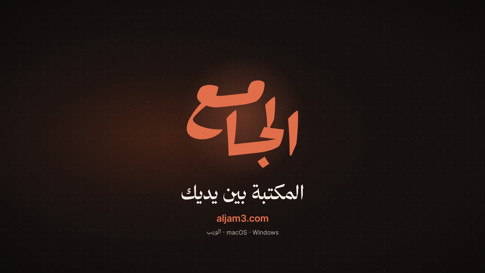
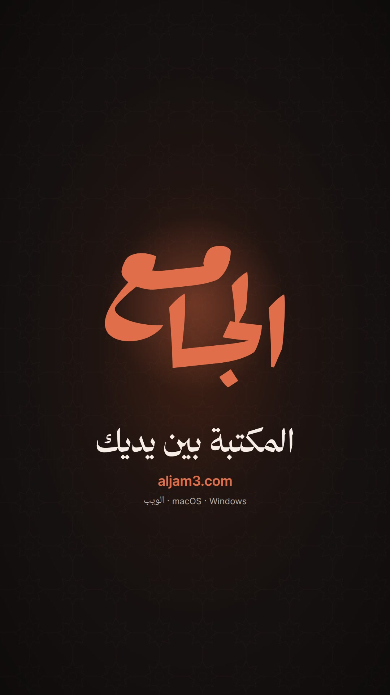

# Aljam3 Desktop — launch film

The Arabic launch film for [Aljam3 Desktop](https://github.com/ieasybooks/aljam3-desktop), built with
[Remotion](https://www.remotion.dev). It is 1:45 long and renders in 16:9 and 9:16 from one timeline.

<p>
  
  
</p>

## Quick start

Requires Node 20+, ffmpeg and Python 3 with [uv](https://docs.astral.sh/uv/).

```sh
cd aljam3-desktop                                     # from the repository root
npm ci
npm run studio                                        # live preview
```

The voice-over and sound effects are committed, so rendering does not need an API key.

## Render

```sh
node scripts/measure.mjs 30                                              # dumps sound events → out/dbg/
uv run --with numpy python scripts/mix_audio.py out/final/mix.wav       # soundtrack (offline mix)
npm run render -- Aljam3Launch-16x9 out/video-16x9.mp4 --muted --crf=17
python3 scripts/finalize.py out/video-16x9.mp4 out/final/aljam3-desktop-launch-16x9.mp4 "الجامع لسطح المكتب" out/final/mix.wav
python3 scripts/gen_captions.py                                          # SRT + VTT
```

Use `Aljam3Launch-9x16` for the vertical version. If Chrome crashes mid-render, point `TMPDIR` at a disk
with more space.

## Layout

| Path | Contents |
| --- | --- |
| `src/ui/` | The app UI rebuilt in React (palette, icons and metrics from `aljam3-desktop`) |
| `src/film/` | Intro, outro, chapter guide, camera and `director.tsx` (cursor, clicks, app state) |
| `src/lib/timeline.ts` | Narration timing; everything on screen is cued from spoken words |
| `data/script.json` | Narration script with full tashkeel, voice settings and per-line seeds |
| `data/*.json` | aljam3.com API snapshots → `scripts/gen_demo_data.py` → `src/data/demo.json` |
| `audio/` | Raw ElevenLabs voice takes and sound effects |
| `public/` | Fonts, icons, brand, page images and the prepared audio used by the film |
| `scripts/` | Voice-over, audio, render and QA tools |

## Voice-over

Rebuilding the voice-over needs `ELEVENLABS_API_KEY` in `.env` (see `.env.example`).

```sh
python3 scripts/gen_vo.py [clip …]                     # missing (or named) clips → audio/vo/
uv run --with numpy python scripts/qa_vo.py            # speech-to-text check against the script
uv run --with numpy python scripts/clean_vo.py         # trim ends and tighten pauses
uv run --with numpy python scripts/prepare_audio.py    # loudness-match → public/audio, src/data/vo.json
uv run --with numpy python scripts/pause_map.py        # pauses and pace per line
uv run --with torch --with transformers python scripts/phonemes.py audio/vo/dl3.mp3   # check tanween
```

Speech-to-text ignores tanween and case endings, so `phonemes.py` checks that they are actually spoken.

## Credits

- Fonts: Noto Naskh Arabic UI, Kitab and Inter (SIL OFL, see `public/fonts/`), plus Thmanyah Serif Display,
  taken from the app.
- Icons: [Lucide](https://lucide.dev) (ISC, see `public/icons/LICENSE`).
- Voice and sound effects: [ElevenLabs](https://elevenlabs.io).
- Book data and page images: [aljam3.com](https://aljam3.com).

## License

Code is MIT (see [LICENSE](LICENSE)). The Aljam3 name and logo belong to Aljam3. Remotion has
[its own license](https://www.remotion.dev/license).
