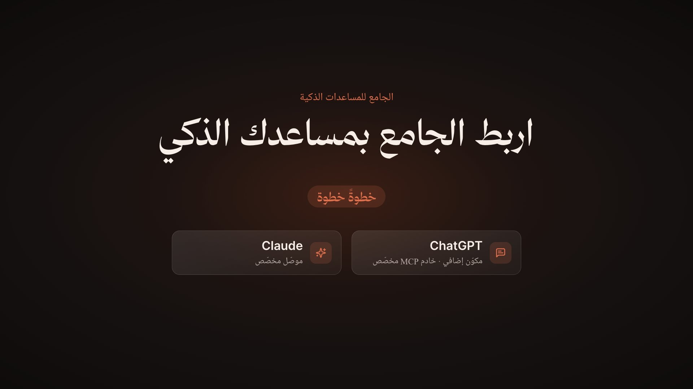

# Aljam3 MCP — setup film

The Arabic how-to film for the [Aljam3 public MCP server](https://aljam3.com/mcp): how to connect it to ChatGPT and
Claude, and how to use it once connected. It follows up the [launch film](../aljam3-mcp/README.md), which people
answered with "how do I actually connect it?". It is built with [Remotion](https://www.remotion.dev), runs about
2:47, and renders in 16:9.

<p>
  
</p>

## What the film shows

Everything inside the browser window is a real recording of the live products, captured in Chrome at 2×. Nothing
in ChatGPT or Claude is redrawn:

1. **The link.** aljam3.com/mcp, copying the connection link.
2. **ChatGPT** (Arabic interface). Plugins → Add → Add custom MCP server; the name and URL, «بدون مصادقة», the
   risk acknowledgement, «إنشاء كمكوّن إضافي», the connection notice and «ربط Aljam3». Then Work mode, `@Aljam3`
   and a question. The answer cites *Riyad al-Salihin* with the page and a link.
3. **Claude** (English interface; Claude has no Arabic UI). Customize → Connectors → Add custom connector; the name
   and URL, the server check that picks *No sign-in*, Add and Connect. Then enabling
   Aljam3 under + → Connectors, a question, *Always allow* on the tool prompt, and the cited answer with its tool
   calls.
4. **The source.** Opening the link Claude cited: page 29 of the al-Arna'ut edition, the hadith in the text and in
   the scanned page.
5. **Tips.** What to check if the option is missing (plan and workspace permissions; Claude's free plan allows one
   custom connector). Then the link to the full guide.

The film adds a cursor, click ripples, keycaps, highlight rings and the camera on top of the recordings. Long
waits (the server check, the assistant working) are sped up, with a badge saying how much. Each scene has its
own camera, so scenes dissolve into each other while the outgoing one eases back to the whole page. A few things
the recordings couldn't capture are drawn: the macOS menu of ChatGPT's native `<select>`, a «تم النسخ» tooltip
(the recorded click on the copy button didn't register), and a smooth scroll in Claude's dialog, where the capture
tool had jumped straight to the Add button.

The assistants' answers are real, from the live `https://aljam3.com/mcp` server on 11 October 2026.

## Quick start

Requires Node 20+, ffmpeg and Python 3 with [uv](https://docs.astral.sh/uv/).

```sh
cd aljam3-mcp-setup                                   # from the repository root
npm ci
npm run studio                                        # live preview
```

The voice-over, sound effects and encoded recordings (`public/clips`) are committed, so rendering needs neither an
API key nor the raw captures.

## Render

```sh
node scripts/measure.mjs                                                 # director data → out/dbg/director.json
python3 scripts/check_choreo.py                                          # late cues, clicks, playback speed per shot
uv run --with pillow python scripts/check_boxes.py                       # every highlight on its recorded frame → out/dbg/boxes.jpg
uv run --with numpy python scripts/mix_audio.py out/final/mix.wav       # soundtrack (offline mix)
npm run render -- McpSetup-16x9 out/video-16x9.mp4 --muted --crf=17
python3 scripts/finalize.py out/video-16x9.mp4 out/final/aljam3-mcp-setup-16x9.mp4 "اربط الجامع بمساعدك الذكي" out/final/mix.wav
python3 scripts/gen_captions.py                                          # SRT + VTT
uv run --with numpy python scripts/qa_video.py out/final/aljam3-mcp-setup-16x9.mp4
```

## How it fits together

| Path | Contents |
| --- | --- |
| `src/film/director.ts` | One shot per recording, each click pinned to the word that asks for it; camera, rings, keycaps, chapters |
| `src/film/clips.ts` | Maps film time to recording time: real speed, hold before the next action, or faster when time is short |
| `src/film/Browser.tsx` | The browser window: recording frames under the camera, cursor and overlays |
| `src/film/Panel.tsx` | The step guide beside the browser, using the products' own button labels |
| `src/film/Intro.tsx`, `Outro.tsx` | The night opening and the tips, guide link and logo at the end |
| `src/lib/timeline.ts` | Narration timing; everything on screen is cued from spoken words |
| `data/script.json` | Narration with full tashkeel, voice settings and seeds (the verify and closing lines reuse the launch film's takes) |
| `scripts/build_clips.py` | Raw captures → `public/clips/*.mp4` (only the ranges the film uses) and `src/data/clips.json` |
| `scripts/grid_crop.py` | A recorded frame with a CSS-pixel grid, for measuring highlight boxes |
| `scripts/capture/` | The capture kit (below) |

## Capturing the recordings

The recordings were made in a signed-in Chrome through its DevTools protocol. Turn on remote debugging at
`chrome://inspect/#remote-debugging`, then:

```sh
node scripts/capture/daemon.mjs &                            # one connection, so Chrome asks only once
TAB=gpt node scripts/capture/c.mjs open https://chatgpt.com/ window
TAB=gpt node scripts/capture/c.mjs mask scripts/capture/mask-gpt.js   # hide history, avatar, other plugins and files
scripts/capture/shoot-gpt-add.sh                             # likewise shoot-gpt-chat.sh, shoot-claude-*.sh
python3 scripts/build_clips.py                               # then adjust RANGES and the director's pins
```

`c.mjs` takes 2× screenshots in a loop while recording (Chrome's screencast only delivers 1× frames) and logs every
move, click and keystroke on the same clock, so the film can place its cursor exactly. The masks hide the account
owner's chat history, name, avatar, other plugins and connectors, and library files by editing the page in the
browser. Edit their lists for your own account. Raw captures go to `archive/captures/` (ignored; about 5 GB).

Things that will need attention when you shoot again:

- The products change. Re-shoot and re-pin the director when a menu moves.
- ChatGPT refuses a second plugin with the same name, so remove an existing Aljam3 plugin before filming the add flow.
- Input coordinates can drift while frames are captured. `c.mjs` checks each move and reapplies the viewport
  emulation, and holds the recorder during clicks.

## Voice-over

Rebuilding the voice-over needs `ELEVENLABS_API_KEY` in `.env` here or at the repository root. The narrator is the
ElevenLabs library voice Rawi on `eleven_multilingual_v2`, the same voice as the other films.

```sh
python3 scripts/gen_vo.py [clip …]                     # missing (or named) clips → audio/vo/
uv run --with numpy python scripts/qa_vo.py            # speech-to-text check against the script
uv run --with numpy python scripts/clean_vo.py         # trim ends and tighten pauses
uv run --with numpy python scripts/prepare_audio.py    # loudness-match → public/audio, src/data/vo.json
```

## Credits

- Fonts: Noto Naskh Arabic UI, Kitab and Inter (SIL OFL, see `public/fonts/`), plus Thmanyah Serif Display,
  taken from the Aljam3 desktop app.
- Icons: [Lucide](https://lucide.dev) (ISC, see `public/icons/LICENSE`).
- Voice and sound effects: [ElevenLabs](https://elevenlabs.io).
- Recordings of aljam3.com, ChatGPT and Claude, made with a real account whose personal data is hidden.

ChatGPT and Claude are trademarks of their owners. The film shows their interfaces only to explain how to connect
Aljam3 to them.

## License

Code is MIT (see [LICENSE](LICENSE)). The Aljam3 name and logo belong to Aljam3. Remotion has
[its own license](https://www.remotion.dev/license).
