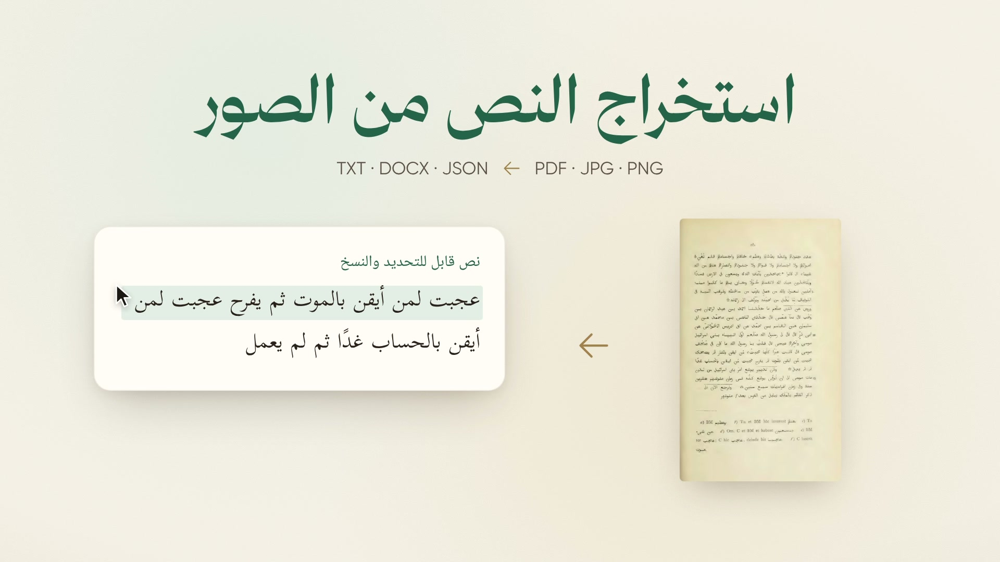
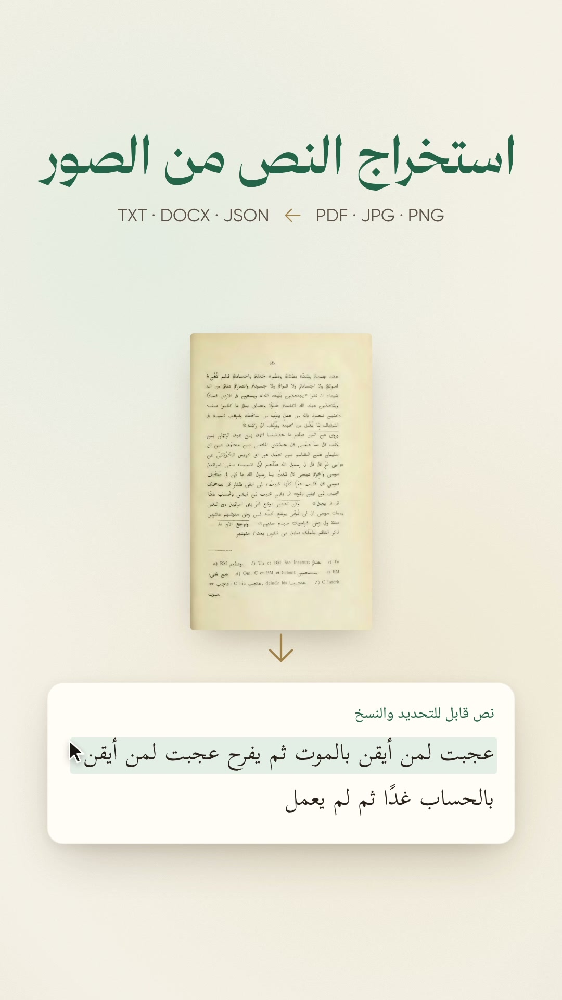

# arabi.tools — OCR launch film

The Arabic sequel to [`../arabi-tools`](../arabi-tools/README.md), announcing **استخراج النص من الصور** at
[arabi.tools/ocr](https://arabi.tools/ocr). One Remotion timeline renders in 1920×1080 and 1080×1920 at 30 fps.
The film runs about 48 seconds. It uses the predecessor's paper, green and gold palette, fonts, logo,
Heroicons, motion helpers, Rawi voice and sound effects. There is no music: only narration, paper/UI effects
and a quiet air bed. The interface is redrawn; browser screenshots are reference material only.

<p>
  
  
</p>

## Story

1. Scanned pages from al-Tabari: a search returns no result, and a cursor cannot select the printed words.
2. The arabi.tools identity; the OCR card joins the existing «تفريغ الصوت» card.
3. The page becomes selectable Arabic text.
4. Drop a PDF, follow page progress, preview each page, and download TXT, Word DOCX or JSON.
5. Automatic language detection, with Arabic text and a Latin editorial note from the same edition.
6. Free, without an account or installation; the input disappears when extraction finishes.
7. The arabi.tools/ocr end card.

## Real source and output

`src/data/تاريخ-الطبري.pdf` contains two image-only pages from the historical edition of **تاريخ الرسل والملوك**
([Internet Archive source](https://archive.org/details/tarkhalrusulwaal01abaruoft)). They are PDF pages 15 and 16
of the fleet corpus file `ia-tarkhalrusulwaal01abaruoft.pdf`, rendered at 200 dpi. The original file has an old
OCR layer; the sample deliberately contains only the scanned page images. `public/scans/page-{1,2}.jpg` are
the exact images embedded in that PDF. `src/data/source.json` records page numbers, provenance and hashes.

`scripts/ocr_on_site.mjs` uploaded this PDF through a real Chrome/Playwright browser on the live site and
clicked all three download links. These files are the site's **unedited downloads**:

- `src/data/ocr.txt`
- `src/data/ocr.docx`
- `src/data/ocr.json`

`src/film/parts/book.tsx` takes literal excerpts from that JSON. Spellings, punctuation and OCR errors are
not repaired. The brief Latin line is a real editorial note from the same book, not a fabricated example.
The film condenses the interaction; its animated progress is not a speed measurement.
`src/data/ocr-provenance.json` records the browser capture. Reference images and status observations are
in ignored `out/qa/` and are never used as film assets.

## Review material

After rendering, the review bundle is in `out/final/`:

- `arabi-tools-ocr-launch-16x9.mp4` and `arabi-tools-ocr-launch-9x16.mp4`
- `arabi-tools-ocr-launch.ar.srt` and `arabi-tools-ocr-launch.ar.vtt` (the same timeline for both videos)
- `contact-sheet-16x9.jpg` and `contact-sheet-9x16.jpg`
- `mix.wav` (the offline soundtrack)
- `delivery.json` (stream validation, exact durations, settings and hashes)

`out/vo_track.mp3` is the narration-only review track. Voice QA, final-video QA and live-site references are
in `out/qa/`. `docs/voice-qa.json` keeps the voice measurements with the source.

## Setup and rendering

Node 20+, ffmpeg and Python 3 are required. The sound, fonts, scans, OCR downloads and prepared narration
are included, so normal rendering needs neither an API key nor another live OCR job.

On the shared fleet machine, begin every shell with the fleet environment. Keep `TMPDIR` on disk, check
free space before rendering, and use `fleet-build` with two render workers:

```sh
. ~/repositories/_fleet/tahweel/env.sh
cd ~/repositories/launches/arabi-tools-ocr
unset npm_config_allow_scripts npm_config_local_prefix
export CHROME_PATH=~/repositories/launches/arabi-tools/node_modules/.remotion/chrome-headless-shell/linux64/chrome-headless-shell-linux64/chrome-headless-shell
df -h /
npm ci
npm run typecheck
npm run studio
```

The renderer uses Remotion's Chrome Headless Shell, PNG frames and BT.709 output. Set `CHROME_PATH`
to an existing compatible headless-shell executable to reuse it. On the fleet, the predecessor's cached binary
was used read-only. System Chrome 150 produced occasional partial frames and is not the reviewed render path.
For the Python commands below, use an environment with NumPy and Pillow (or `uv run --with numpy --with pillow`).

```sh
df -h /
~/repositories/_fleet/cohere/bin/fleet-build node scripts/measure.mjs
python scripts/mix_audio.py out/final/mix.wav

df -h /
~/repositories/_fleet/cohere/bin/fleet-build npm run render -- ArabiToolsOCR-16x9 out/video-16x9.mp4 --muted --crf=17 --concurrency=2
python scripts/finalize.py out/video-16x9.mp4 out/final/arabi-tools-ocr-launch-16x9.mp4 "أدوات العربية — استخراج النص من الصور" out/final/mix.wav

df -h /
~/repositories/_fleet/cohere/bin/fleet-build npm run render -- ArabiToolsOCR-9x16 out/video-9x16.mp4 --muted --crf=17 --concurrency=2
python scripts/finalize.py out/video-9x16.mp4 out/final/arabi-tools-ocr-launch-9x16.mp4 "أدوات العربية — استخراج النص من الصور" out/final/mix.wav
python scripts/gen_captions.py
python scripts/qa_assets.py
python scripts/qa_video.py out/final/arabi-tools-ocr-launch-16x9.mp4
python scripts/qa_video.py out/final/arabi-tools-ocr-launch-9x16.mp4
python scripts/qa_delivery.py
```

Review stills use the same renderer and timeline:

```sh
df -h /
~/repositories/_fleet/cohere/bin/fleet-build node scripts/stills.mjs ArabiToolsOCR-16x9 out/stills/landscape 2 4.3 7.4 8.9 13.6 16.8 21 25.2 27.2 31.6 36.8 40.5 46
python scripts/sheet.py out/final/contact-sheet-16x9.jpg 3 640 out/stills/landscape-*.png
```

Use `ArabiToolsOCR-9x16`, the `portrait` prefix and `4 270` for the vertical sheet. Intermediate video files,
bundles and rejected voice takes can be removed after QA; keep the final MP4s in the ignored `out/final/`.

## Narration and voice QA

`data/script.json` preserves the coordinator's ten clip IDs, fully vocalized Arabic text and captions exactly.
The voice is Rawi (`F2jHHIMyJTh1pdwoLzNQ`) on `eleven_multilingual_v2`: stability 0.55, similarity 0.8,
style 0, speaker boost enabled, speed 1.1. The base seed is 1408. Accepted clip-specific seeds and hashes
are recorded in `data/voice-takes.json`; rejected takes are documented there too.

Rebuilding narration reads `ELEVENLABS_API_KEY` directly from the ignored monorepo `.env`. Do not copy it.

```sh
python scripts/gen_vo.py [clip …]
python scripts/qa_vo.py
python scripts/clean_vo.py
python scripts/prepare_audio.py
python scripts/qa_vo.py --prepared
OMP_NUM_THREADS=2 HF_HUB_OFFLINE=1 python scripts/phonemes.py --json out/qa/phonemes-prepared.json public/audio/vo/*.wav
python scripts/voice_report.py
python scripts/voice_track.py
```

The phoneme script uses the predecessor's cached `facebook/wav2vec2-xlsr-53-espeak-cv-ft` model. On the fleet,
its Python environment is `~/.cache/aljam3-asr/.venv/bin/python`. It runs with two Torch threads and should
be wrapped in `fleet-build`. STT checks the words (including PDF and Word); it cannot prove tanween. The
separate phoneme report records the actual /an/ and /in/ evidence and case endings. The report also records
speech pace, clause pauses and the seeds used. The recognizer is imperfect; final listening remains part of
owner review. Regenerate unclear endings with another seed without changing the approved script.

The cleaner trims silence and a stray post-line onset, and tightens one clause pause. It does not time-stretch
speech. Alignment remapping includes crossfade duration, so later cues stay synchronized. Caption time
formatting carries milliseconds correctly and caps cues before the next cue. Finalization pads the mix
to the frame-aligned video duration and retains every video frame (no `-shortest` truncation).

## Reproducing the source capture

This is unnecessary for rendering and consumes real OCR/TTS usage. The original source PDF is a read-only
fleet input. `prepare_sample.py` requires PyMuPDF; `ocr_on_site.mjs` uses Playwright from `NODE_PATH`.

```sh
python scripts/prepare_sample.py /path/to/ia-tarkhalrusulwaal01abaruoft.pdf
NODE_PATH=~/repositories/arlang.tools/tests/browser/node_modules node scripts/ocr_on_site.mjs src/data/تاريخ-الطبري.pdf
```

## Code and credits

`src/lib/timeline.ts` sets narration order and gaps; `src/film/times.ts` ties actions to spoken words.
`src/film/scenes/` contains Hook, Brand, Tool, Site, Free/Privacy and Outro. `src/film/sounds.ts` supplies
both preview sound and the offline mix. The two compositions share every action and voice cue.

- Fonts: Gilroy, Thmanyah Serif Display, Kitab and Noto Naskh Arabic UI, copied from the preceding film.
  Kitab and Noto license files are in `public/fonts/`.
- Icons: Heroicons (MIT); logo/name: iEasyBooks (الكتب الميسّرة).
- Narration and inherited effects: ElevenLabs. OCR output: arabi.tools.
- Scans: historical edition before 1921; public-domain status inferred from age in the fleet `MANIFEST.md`.
- No new npm dependencies. The optional PDF preparation script uses PyMuPDF (AGPL-3.0); Playwright is Apache-2.0.

Code is MIT; see [LICENSE](LICENSE). Remotion has [its own license](https://www.remotion.dev/license).
