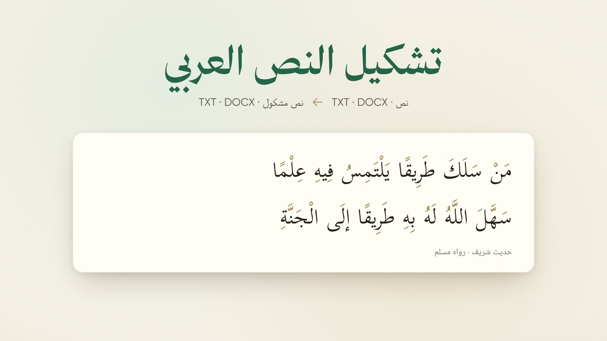
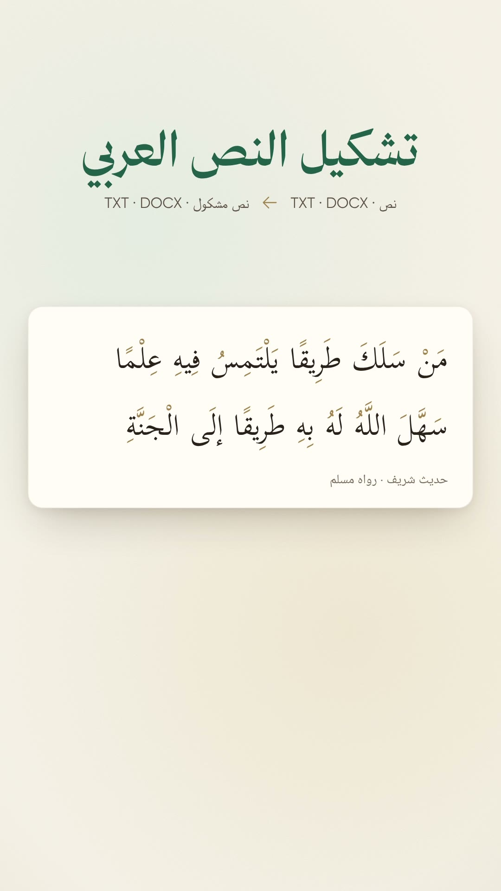

# arabi.tools — diacritization launch film

The Arabic launch film for **تشكيل النص العربي** at [arabi.tools/diacritize](https://arabi.tools/diacritize), the
third tool after [`../arabi-tools`](../arabi-tools/README.md) (transcription) and
[`../arabi-tools-ocr`](../arabi-tools-ocr/README.md) (OCR). One Remotion timeline renders in 1920×1080 and
1080×1920 at 30 fps. The film runs about 48 seconds. It uses the earlier films' paper, green and gold palette,
fonts, logo, Heroicons, motion helpers, Rawi voice and sound effects. There is no music: only narration,
paper/UI effects and a quiet air bed. The interface is redrawn; browser screenshots are reference material only.

<p>
  
  
</p>

## Story

1. The undiacritized word «علم» splits into four readings: عِلْمٌ، عَلَمٌ، عَلِمَ، عَلَّمَ. Then a whole page of
   such words.
2. The arabi.tools identity; the diacritization card joins «تفريغ الصوت» and «استخراج النص من الصور».
3. The tool's name, and a hadith whose diacritics settle onto it word by word.
4. Paste the hadith, choose CATT over شكِّلها, and get it back diacritized.
5. Upload a Word document and download the diacritized DOCX.
6. Free, without an account or installation; the original and the result are deleted after 30 minutes.
7. The arabi.tools/diacritize end card.

## Real input and output

Every diacritized text in the film is the live site's **unedited output**. `scripts/diacritize_on_site.mjs`
drove a real Chrome/Playwright visitor through arabi.tools/diacritize for each input in `data/inputs.json`:
choose the model, paste the text (or upload the document), wait for the result and click its download link.
`src/data/site.json` keeps each input, result, timing and download hash:

- `hadith-shakkelha`, `hadith-catt`: «من سلك طريقا يلتمس فيه علما سهل الله له به طريقا إلى الجنة»
  (Sahih Muslim 2699), with each model. The results are in `src/data/hadith-*-result.txt`. Each job
  finished in under a second.
- `lesson-catt`: `src/data/فضل-العلم.docx`, a plain lesson sheet with that hadith and Sahih Muslim 1631, written
  by `scripts/make_docx.py`. The site's DOCX result is `src/data/lesson-catt-result.docx`, and
  `scripts/extract_docx.py` copies both documents' paragraphs into `src/data/lesson.json`.

The Tool scene shows شكِّلها's result. The site walkthrough selects CATT, so the text and document results on
screen are CATT's. With the diacritics removed, each result equals its input, so neither model changed a letter.
`scripts/qa_assets.py` checks this together with the hashes. The film condenses the interaction; its progress
bars are not speed measurements.

## Diacritics in gold

Diacritics are drawn in gold and land on each word in reading order. Chrome paints a mark in the colour of
its letter, and Kitab widens some letters when they carry marks, so neither coloured spans nor an overlay of
the plain text works. `scripts/split_font.py` derives two fonts from `public/fonts/Kitab.ttf` with the same
shaping tables:

- **KitabLetters** draws everything except the diacritics. Hamza and madda stay, because they are spelling.
- **KitabMarks** draws only the diacritics.

Stacked, the two fonts reproduce Kitab glyph for glyph (`src/film/parts/marks.tsx`). The script flattens
composite glyphs first, because Kitab builds its damma from another glyph. It also drops Kitab's hamza+vowel
ligatures, so a hamza and its vowel stay separate glyphs. Both derived fonts remain under Kitab's SIL Open Font
License and avoid its reserved names, «Scheherazade» and «SIL».

## Review material

After rendering, the review bundle is in `out/final/`:

- `arabi-tools-tashkeel-launch-16x9.mp4` and `arabi-tools-tashkeel-launch-9x16.mp4`
- `arabi-tools-tashkeel-launch.ar.srt` and `arabi-tools-tashkeel-launch.ar.vtt` (the same timeline for both videos)
- `contact-sheet-16x9.jpg` and `contact-sheet-9x16.jpg`
- `mix.wav` (the offline soundtrack)
- `delivery.json` (stream validation, exact durations, settings and hashes)

`out/vo_track.mp3` is the narration-only review track. Voice QA, final-video QA and live-site references are
in `out/qa/`. `docs/voice-qa.json` keeps the voice measurements with the source.

## Setup and rendering

Node 20+, ffmpeg and Python 3 are required. The sound, fonts, site results and prepared narration are
included, so normal rendering needs neither an API key nor another live job.

On the shared machine, keep `TMPDIR` off the small `/tmp` tmpfs, check free space before rendering, and render
with two workers:

```sh
cd ~/repositories/launches/arabi-tools-tashkeel
unset npm_config_allow_scripts npm_config_local_prefix
export TMPDIR=/dev/shm/tashkeel-film/tmp && mkdir -p "$TMPDIR"
export CHROME_PATH=~/repositories/launches/arabi-tools/node_modules/.remotion/chrome-headless-shell/linux64/chrome-headless-shell-linux64/chrome-headless-shell
df -h /
npm ci
npm run typecheck
npm run studio
```

The renderer uses Remotion's Chrome Headless Shell, PNG frames and BT.709 output. Set `CHROME_PATH` to an
existing compatible headless-shell executable to reuse it. For the Python commands below, use an environment
with NumPy and Pillow (or `uv run --with numpy --with pillow`).

```sh
node scripts/measure.mjs
python scripts/mix_audio.py out/final/mix.wav

npm run render -- ArabiToolsTashkeel-16x9 out/video-16x9.mp4 --muted --crf=17 --concurrency=2
python scripts/finalize.py out/video-16x9.mp4 out/final/arabi-tools-tashkeel-launch-16x9.mp4 "أدوات العربية — تشكيل النص العربي" out/final/mix.wav

npm run render -- ArabiToolsTashkeel-9x16 out/video-9x16.mp4 --muted --crf=17 --concurrency=2
python scripts/finalize.py out/video-9x16.mp4 out/final/arabi-tools-tashkeel-launch-9x16.mp4 "أدوات العربية — تشكيل النص العربي" out/final/mix.wav
python scripts/gen_captions.py
python scripts/qa_assets.py
python scripts/qa_video.py out/final/arabi-tools-tashkeel-launch-16x9.mp4
python scripts/qa_video.py out/final/arabi-tools-tashkeel-launch-9x16.mp4
python scripts/qa_delivery.py
```

Review stills use the same renderer and timeline:

```sh
node scripts/stills.mjs ArabiToolsTashkeel-16x9 out/stills/landscape 1.5 4.6 7.6 12.4 15.2 17.6 20.6 21.4 24.8 28.6 32.4 36.4 39.9 46.5
python scripts/sheet.py out/final/contact-sheet-16x9.jpg 3 640 out/stills/landscape-*.png
```

Use `ArabiToolsTashkeel-9x16`, the `portrait` prefix and `5 270` for the vertical sheet. Intermediate video
files, bundles and rejected voice takes can be removed after QA; keep the final MP4s in the ignored `out/final/`.

## Narration and voice QA

`data/script.json` holds the ten clip IDs, fully vocalized Arabic text and captions. Three lines are the OCR
film's own takes, copied unchanged: `brand`, `free` and `outro`. The CATT model is spoken «كات» and captioned
CATT. The voice is Rawi (`F2jHHIMyJTh1pdwoLzNQ`) on `eleven_multilingual_v2`: stability 0.55, similarity 0.8,
style 0, speaker boost enabled, speed 1.1. The base seed is 1408. Accepted clip-specific seeds and hashes are
recorded in `data/voice-takes.json`; rejected takes are documented there too.

Rebuilding narration reads `ELEVENLABS_API_KEY` from the ignored monorepo `.env`. Do not copy it.

```sh
python scripts/gen_vo.py [clip …]
python scripts/qa_vo.py
python scripts/clean_vo.py
python scripts/prepare_audio.py
python scripts/qa_vo.py --prepared
OMP_NUM_THREADS=2 HF_HUB_OFFLINE=1 python scripts/phonemes.py --json out/qa/phonemes-prepared.json public/audio/vo/*.wav
python scripts/voice_report.py
python scripts/voice_track.py
```

The phoneme script uses the cached `facebook/wav2vec2-xlsr-53-espeak-cv-ft` model, which on this machine lives
in `~/.cache/aljam3-asr/.venv/bin/python`. STT checks the words; it cannot prove tanween, so the phoneme report
records the /an/, /un/ and /in/ evidence. A whole-clip decode can blur an ending; decoding the word's own
segment (`file.wav@start@end`) settles it. The report also records pace (about 2 words per second), clause
pauses and seeds. The recognizer is imperfect; final listening remains part of owner review.

## Reproducing the site results

This is unnecessary for rendering and runs real jobs on the live site. Playwright comes from `NODE_PATH`.

```sh
uv run --with python-docx python scripts/make_docx.py
NODE_PATH=~/repositories/arlang.tools/tests/browser/node_modules node scripts/diacritize_on_site.mjs data/inputs.json
python scripts/extract_docx.py
uv run --with fonttools python scripts/split_font.py
```

## Code and credits

`src/lib/timeline.ts` sets narration order and gaps; `src/film/times.ts` ties actions to spoken words.
`src/film/scenes/` contains Hook, Brand, Tool, Site, Free/Privacy and Outro. `src/film/sounds.ts` supplies
both preview sound and the offline mix. The two compositions share every action and voice cue.

- Fonts: Gilroy, Thmanyah Serif Display, Kitab and Noto Naskh Arabic UI, copied from the preceding films;
  KitabLetters and KitabMarks are derived from Kitab. Kitab and Noto license files are in `public/fonts/`.
- Icons: Heroicons (MIT); logo/name: iEasyBooks (الكتب الميسّرة).
- Narration and inherited effects: ElevenLabs. Diacritization: arabi.tools, running
  [شكِّلها](https://github.com/AliOsm/shakkelha) (MIT) and [CATT](https://github.com/abjadai/catt) (Apache-2.0).
- No new npm dependencies. The optional helper scripts use python-docx (MIT), fontTools (MIT) and
  Playwright (Apache-2.0).

Code is MIT; see [LICENSE](LICENSE). Remotion has [its own license](https://www.remotion.dev/license).
