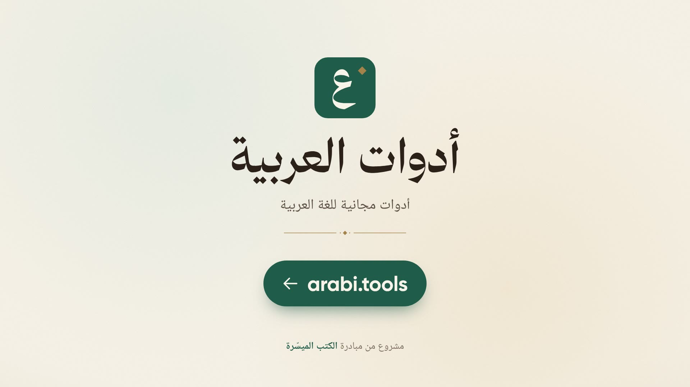
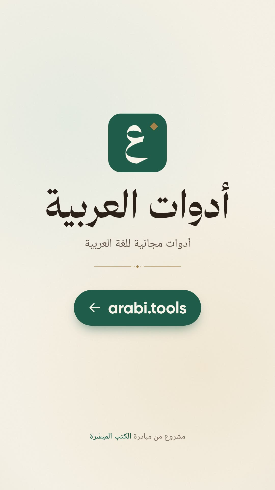

# arabi.tools — launch film

The Arabic launch film for [arabi.tools](https://arabi.tools) (أدوات العربية), free tools for the Arabic language,
starting with audio transcription. It is a motion-graphics film built with [Remotion](https://www.remotion.dev),
runs about one minute, and renders in 16:9 and 9:16 from one timeline.

<p>
  
  
</p>

## What the film shows

1. **Recordings nobody can search.** Lessons, lectures and interviews as audio files; a search that finds nothing
   and quote marks that have nothing to hold. The waveform moves with the narrator's own voice.
2. **The site.** The waveform gathers into the logo's tile, then the name, arabi.tools, and who it is for.
3. **The first tool.** Bars leave the waveform and become the words of a transcript.
4. **How it works.** The transcription page, rebuilt in the site's design: drop an MP3, start, follow the progress,
   then download the text (TXT) and the subtitles (SRT) and see them on a video.
5. **Free and private.** No account, nothing to install, and the audio file deleted when the transcription ends.
6. **More to come**, and the end card with the address.

The transcript in the film is real. The film's own narration (`out/vo_track.mp3`, written by
`scripts/voice_track.py`) was uploaded to the live site, and `src/data/transcript.json` holds what the site
returned, unedited: its SRT cues and TXT file. That is why the cues read «ادوات» without a hamza and «ام بي ثري»
for MP3: that is how the site writes them.

The look follows the site: its paper, green and gold palette, its fonts, its logo and ornament, and its
Heroicons. Nothing is a screenshot; the page is redrawn so it stays sharp at any size.

## Quick start

Requires Node 20+, ffmpeg and Python 3 with [uv](https://docs.astral.sh/uv/).

```sh
cd arabi-tools                                        # from the repository root
npm ci
npm run studio                                        # live preview
```

The voice-over, sound effects and transcript are committed, so rendering needs no API key.

## Render

```sh
node scripts/measure.mjs                                                 # key times and sound events → out/dbg/director.json
uv run --with numpy python scripts/mix_audio.py out/final/mix.wav       # soundtrack (offline mix)
npm run render -- ArabiTools-16x9 out/video-16x9.mp4 --muted --crf=17
python3 scripts/finalize.py out/video-16x9.mp4 out/final/arabi-tools-launch-16x9.mp4 "أدوات العربية" out/final/mix.wav
python3 scripts/gen_captions.py                                          # SRT + VTT
uv run --with numpy python scripts/qa_video.py out/final/arabi-tools-launch-16x9.mp4
```

Use `ArabiTools-9x16` for the vertical version. Render with `TMPDIR` on a disk or `/dev/shm` with room to spare;
Chrome crashes when the temporary directory fills up. `node scripts/stills.mjs ArabiTools-16x9 out/stills/s 12.5 30`
renders single frames, and `scripts/sheet.py` lays them out on a contact sheet.

## How it fits together

| Path | Contents |
| --- | --- |
| `src/lib/timeline.ts` | Narration order and pauses; `cue()` finds when a word is spoken |
| `src/film/times.ts` | Every key moment of the film, taken from spoken words |
| `src/film/scenes/` | The scenes: `Hook`, `Brand`, `Tool`, `Site` (upload to download), `Free` (and privacy), `More`, `Outro` |
| `src/film/parts/` | The site's logo and icons, and the shared pieces: waveform bars, file card, buttons, cursor |
| `src/film/sounds.ts` | Sound design, timed from the same moments as the picture |
| `src/lib/voice.ts` | Waveform heights from the narration's loudness and spectrum (`src/data/voice.json`) |
| `src/data/transcript.json` | The site's transcript of the narration |
| `data/script.json` | Narration with full tashkeel, voice settings and seed |

## Voice-over

Rebuilding the voice-over needs `ELEVENLABS_API_KEY` in `.env` here or at the repository root. The narrator is the
ElevenLabs library voice Rawi on `eleven_multilingual_v2`, the same voice as the other films.

```sh
python3 scripts/gen_vo.py [clip …]                     # missing (or named) clips → audio/vo/
uv run --with numpy python scripts/qa_vo.py            # speech-to-text check against the script
uv run --with torch --with transformers python scripts/phonemes.py audio/vo/brand2.mp3   # check tanween
uv run --with numpy python scripts/clean_vo.py         # trim ends and tighten pauses
uv run --with numpy python scripts/prepare_audio.py    # loudness-match → public/audio, src/data/vo.json
uv run --with numpy python scripts/voice_track.py      # narration track + src/data/voice.json
```

Speech-to-text ignores tanween and case endings, so `phonemes.py` checks that they are actually spoken.
`python3 scripts/gen_sfx.py` regenerates the sound effects.

After changing the narration or its pauses, transcribe it again so the film shows the site's output for the
narration it plays (this needs `puppeteer-core` somewhere on `NODE_PATH` and Google Chrome):

```sh
NODE_PATH=/path/to/node_modules node scripts/transcribe_on_site.mjs out/vo_track.mp3 src/data/transcript.json
```

## Credits

- Fonts, taken from arabi.tools: Gilroy, Thmanyah Serif Display, Kitab and Noto Naskh Arabic UI (the last two
  under the SIL OFL, see `public/fonts/`).
- Icons: [Heroicons](https://heroicons.com) (MIT), as on the site.
- Voice and sound effects: [ElevenLabs](https://elevenlabs.io).
- Transcript: [arabi.tools](https://arabi.tools).

## License

Code is MIT (see [LICENSE](LICENSE)). The arabi.tools name and logo belong to iEasyBooks
(الكتب الميسّرة). Remotion has [its own license](https://www.remotion.dev/license).
