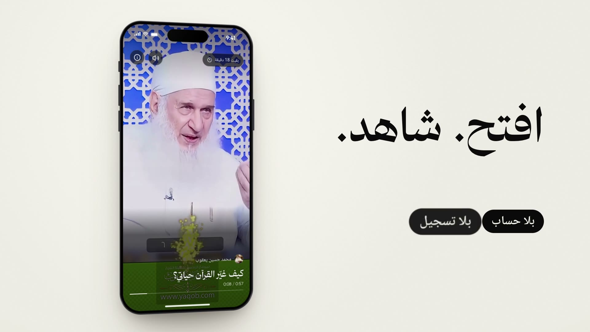
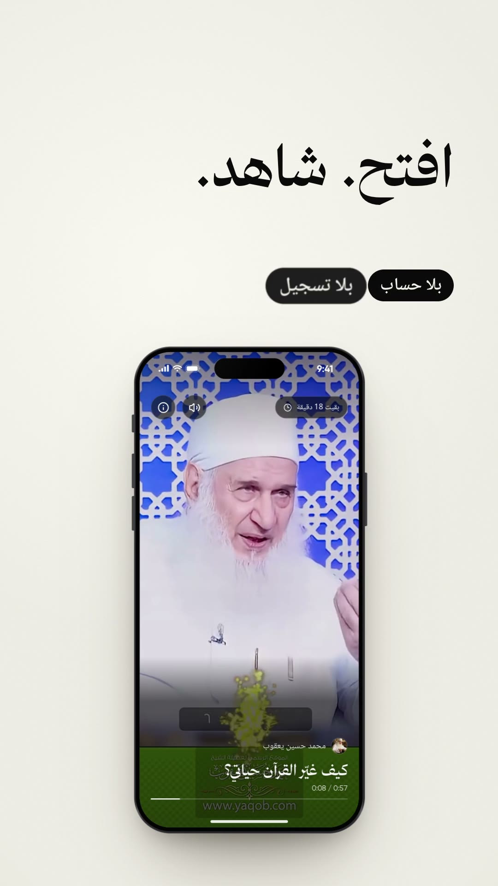

# Mofied (مفيد) — launch film

The launch film for **Mofied** at [mofied.com](https://mofied.com) and on the App Store, Google Play and
AppGallery: short, carefully chosen Islamic media, with reminders between clips and a finite session that ends
with «حان وقت التوقّف». One Remotion timeline renders the film in **Arabic (about 53 s)** and **English (about
49 s)**, each in 1920×1080 and 1080×1920, at **60 fps**.

<p>
  
  
</p>

The film uses the app's own palette and fonts (Thmanyah, Noto Naskh Arabic UI, Kitab and Gilroy), the supplied
Mofied mark and the ivory editorial look of the store listing. There is no music: only narration, non-musical
sound (glass, paper, air, wood, a room) and deliberate silence. The app is redrawn from its source on a drawn
iPhone (Black Titanium, Dynamic Island, real safe areas); nothing on screen is a screenshot.

## Story

1. **Hook.** An abstract feed flicks faster and faster under a racing clock: «فتحتَ هاتفك لدقيقة… فضاعت ساعة.»
   A hard cut to silence. The feed has no real apps, logos, people or content.
2. **Turn.** «ماذا لو كان ما تشاهده يبقى معك؟» lands word by word; the mark slams in with «مفيد» and «شاهد ما يبقى معك.»
3. **Easy.** The mark becomes the app icon on an iPhone home screen and is tapped open, iOS-style, into a playing
   clip. The iPhone turns in 3D toward «افتح. شاهد. اسحب.», with «بلا حساب» and «بلا تسجيل», and two swipes go
   through the feed.
4. **Curated.** The iPhone settles into a wall of iPhones. On «بعناية» the generic feed cards drop away and the real
   clips close ranks.
5. **Reminder.** The frame fades to dark for a real reminder at full size (Ṣād 38:29 in Arabic, Al-Furqan 25:62 in
   English), revealed as if read, with its countdown. It then slides up, as in the app, for the next clip.
6. **Session end.** The remaining time counts down 3, 2, 1 minutes, enlarged beside the phone, and the app's ending
   takes the whole frame: «حان وقت التوقّف». It dissolves into «ثم عُد إلى يومك.» in warm daylight.
7. **Free.** The day fades into «مجاني بالكامل.», then two hard cuts, «بلا إعلانات.» and «بلا حساب.», each on its
   spoken word.
8. **End card.** Centred: mark, tagline, the three official store badges (App Store first, each arriving as its
   store is named) and mofied.com.

Every visual action is timed from a spoken word (`src/film/times.ts`).

## Real content

`src/data/content.json` holds unedited records from the live Faqieh session API
(`https://faqieh.com/api/v1/mofied/session`, fetched 9 November 2026): the clips, their titles, speakers and
durations, the reminders, the ending text and the 20-minute session policy. The clips in `public/media/` are
short segments of those items' public HLS streams; the wall's stills come from the same clips:

- Muhammad Hussein Yaqub, «كيف غيّر القرآن حياتي؟» (opens the app)
- Iyad Qunaibi, «كلمة تغرسها اليوم قد تُنقذه بعد سنوات» (first swipe)
- Ahmad Al-Sayyid, «يا أهل الخير.. استبقوا أنفسكم» (second swipe, and the clip the iPhone carries into the wall)
- Maher Yasin al-Fahl, «ليكن لك عظةٌ في كل شيء حولك .» (the session's last clip)
- On the wall as well: Saeed Al-Kamali and Raghib al-Sirjani

The film condenses time: the reminder's countdown runs out quickly after the reading pause, and the session's
last minutes are compressed to a few seconds. The interface and copy are otherwise the app's
(`apps/mobile/src/App.tsx`, `Reminder.tsx`, `Ending.tsx` and `docs/design/player-overlay.md` in the mofied repository).

## Narration

The narrator is **Mazen Lawand** (`rPNcQ53R703tTmtue1AT`, ElevenLabs voice library, Modern Standard Arabic, listed
as Arabic–English bilingual) on **`eleven_v4`**, stability 0.5, similarity 0.8, seed 2024: the owner's pick from
an audition of four readings of the same passage.

Each language is generated as **one continuous take** from plain text (vowel marks only where a word could be
misread), so the delivery flows from line to line. `scripts/gen_take.py` cuts the take into the script's lines
only at real silences found in the waveform, keeps one gain for all of them, and `src/lib/timeline.ts` adds the
film's extra pauses between lines. `scripts/qa_cuts.py` checks that every line starts and ends in silence, so no
word is split when a pause is added.

Lines changed after the take are re-recorded alone and spliced in by `scripts/patch_line.py` (same voice, the
neighbouring lines as context, the take's level, a natural tail): «افتحهُ وابدأ المشاهدة فورًا»; «مُحتوًى نظيف»
(spelled «مُحْتَوَنْ» for the narrator so the tanween is spoken); and the free line with «وبلا حساب» / "no account".
Their text and seeds are in `data/script-ar.json` and `data/script-en.json`.

- The English script writes the name as «مُفيد» so the narrator says it natively, and the domain as
  "Mu-feed dot com". Captions say Mofied and mofied.com.
- `scripts/qa_take.py` checks each take with ElevenLabs Scribe. English matches word for word; in Arabic, Scribe
  writes the store names in Latin letters.

```sh
python scripts/gen_take.py ar                 # or en; --split-only re-cuts the existing take
python scripts/qa_take.py ar
python scripts/patch_line.py ar easy1 "افتحهُ وابدأ المشاهدة فورًا،" افتحه      # re-apply each patched line
python scripts/patch_line.py ar curated2 "مُحْتَوَنْ نَظِيفْ، خالٍ من المحرّمات." نظيف
python scripts/patch_line.py ar free "مجاني بالكامل، وبلا إعلانات، وبلا حساب." حساب
python scripts/patch_line.py en free "Completely free, no ads, no account." account 2024 2025
python scripts/qa_cuts.py ar && python scripts/qa_cuts.py en
python scripts/prepare_audio.py
```

Rebuilding narration or sound reads `ELEVENLABS_API_KEY` from the ignored monorepo `.env`. Do not copy it.

## Sound

`scripts/gen_sfx.py` generates fourteen effects with ElevenLabs Sound Effects v3 (`eleven_text_to_sound_v3`);
the prompts are kept in `audio/sfx_raw/prompts.json`. `scripts/qa_sfx.py` rejects any effect with a sustained
pitch (a bell, chime, ring or musical tone); it flags a test bell tone and passes every effect here. Whooshes are
kept low. The mix is dialogue-led, and the master is −14 LUFS with true peaks around −1.9 dBTP.

## Rendering

Node 20+, ffmpeg and Python 3 with NumPy are required (Pillow for contact sheets: `uv run --with pillow`). The
narration, sound, fonts, clips and data are included, so rendering needs no API key.

```sh
cd launches/mofied
npm ci
npm run typecheck
npm run studio                       # compositions Mofied-ar-16x9, Mofied-ar-9x16, Mofied-en-16x9, Mofied-en-9x16
./scripts/render_all.sh              # or: ./scripts/render_all.sh ar
python scripts/gen_captions.py ar && python scripts/gen_captions.py en
python scripts/qa_video.py out/final/mofied-launch-ar-16x9.mp4
python scripts/qa_delivery.py
```

`render_all.sh` measures each language (`scripts/measure.mjs`), mixes its soundtrack offline
(`scripts/mix_audio.py`), renders both shapes muted and remuxes them with the mix (`scripts/finalize.py`).
Set `CONCURRENCY` to change the render workers (default 6). The final MP4s, SRT/VTT captions, mixes and
`delivery.json` (stream checks and hashes) are written to the ignored `out/final/`.

Review stills: `node scripts/stills.mjs Mofied-ar-16x9 out/stills/ar 2 8 13 19 25 31 35 39 47` and
`uv run --with pillow python scripts/sheet.py out/stills/sheet.jpg 3 640 out/stills/ar-*.png`.

## Delivery notes

- 9:16: text, badges and the address stay inside the area that Shorts, Reels and TikTok leave clear
  (288 px top, 672 px bottom, 192 px sides).
- Store badges are the official localized artwork (from the Faqieh web app's `store-badges`), unmodified. They
  arrive one by one as each store is named, at the owner's request. Brand-guideline matters (badge animation,
  credit lines, iPhone imagery shown at an angle, paid-campaign approval) are the owner's to handle.

## Code and credits

`src/lib/timeline.ts` sets narration order and pauses; `src/film/times.ts` ties actions to spoken words;
`src/film/parts/app.tsx` redraws the app and the iPhone; `src/film/scenes/` holds Hook, Turn, PhoneStage, Words,
Wall, Stages (reminder, ending, day, free) and Outro; `src/film/sounds.ts` drives both the Studio preview and the
offline mix.

- Fonts: Thmanyah Serif Display, Noto Naskh Arabic UI (OFL), Kitab (OFL) and Gilroy, from the Mofied design package.
- Icons: lucide (ISC), the same geometry as the app. Mark and name: Mofied.
- Narration and sound effects: ElevenLabs. Media, titles, reminders and ending: Faqieh / Mofied.
- Store badges: Apple, Google and Huawei; used under their badge guidelines.

Code is MIT; see [LICENSE](LICENSE). Remotion has [its own license](https://www.remotion.dev/license).
